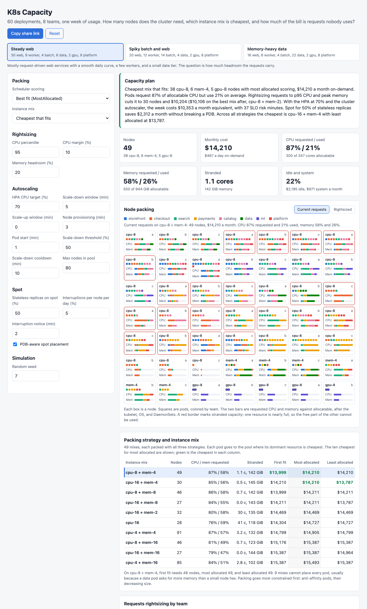

# K8s Capacity

A browser tool for Kubernetes capacity planning and cost, the analysis a platform team runs before a budget review or a cluster redesign. It generates a synthetic cluster of 60 deployments across 8 teams with requests, limits, replicas, PodDisruptionBudgets, anti-affinity, zone spread, GPU and high-memory pods, and a week of usage at 5 minute resolution. It then bin-packs the pods onto 49 candidate instance mixes with three scheduler scoring strategies, finds the cheapest mix that fits, rightsizes requests from usage percentiles, simulates the HPA and cluster autoscaler minute by minute for the week, puts stateless replicas on spot against PDBs, and splits the bill by team with idle and system overhead shown separately.



## Why

Most clusters are sized by requests, and most requests are guesses made when a service first shipped. The result is a cluster that is 80% or more allocated and 20% used, and a node count that nobody can explain line by line. The questions that come up in a budget review are concrete: which instance types should the node pools use, how many nodes would we need if requests matched use, how much does autoscaling save over a static plan and what does it cost in latency risk, how much of the stateless tier can run on spot without breaking a PodDisruptionBudget, and which team is paying for what. Each of these is a small model. This puts them on one cluster so they can be compared.

Results for the three presets (seed 7, MostAllocated scoring, cheapest mix for that strategy, illustrative prices):

| Preset | Static plan | CPU requested / used | Rightsized, same mix | HPA 50% / 70% / 85%, monthly | SLO risk min at 50% / 85% | Spot 50%: saving, PDB breach |
|---|---|---|---|---|---|---|
| Steady web | 49 nodes (38 cpu-8, 6 mem-4, 5 gpu-8), $14,210 | 87% / 21% | 30 nodes, $10,204 | $11,211 / $10,353 / $10,039 | 16 / 97 | $2,312 (16%), 0 min |
| Spiky batch and web | 46 nodes (39 cpu-8, 3 mem-16, 4 gpu-8), $14,601 | 87% / 18% | 33 nodes, $11,849 | $11,391 / $10,538 / $10,239 | 144 / 519 | $2,244 (15%), 0 min |
| Memory-heavy data | 22 nodes (14 cpu-16, 6 mem-16, 2 gpu-8), $12,631 | 79% / 19% | 20 nodes, $11,784 | $10,958 / $10,136 / $9,999 | 4 / 35 | $1,033 (8%), 0 min |

What the steady preset shows:

- **Requests, not use, set the node count.** Pods request 87% of allocatable CPU and use 21%. Rightsizing every deployment to its p95 CPU plus 10% and its peak memory plus 20% drops the same mix from 49 to 30 nodes, $4,006 a month. The catalog team requests 5.2 times the CPU it uses at p95, and platform 3.9 times.
- **The scoring strategy matters less than the mix and the constraints.** On cpu-8 plus mem-4, first fit needs 48 nodes and MostAllocated 49. Across mixes the spread is wider: the ten cheapest for MostAllocated run from $14,210 to $15,493 a month, and the cheapest of all is cpu-16 plus mem-4 with LeastAllocated at $13,787, and 9 of 49 mixes cannot place every pod because a data pod asks for more memory than a small node has. Packing anti-affinity pods first, before the nodes fill up, saved 4 nodes on cpu-16 alone.
- **Autoscaling buys about 27% and costs latency risk.** With the HPA at 70% and the cluster autoscaler, the cpu-8 pool averages 19.8 nodes against 38 in the static plan, and the cluster costs $10,353 a month. Moving the target from 50% to 85% saves another $1,172 a month but raises SLO risk minutes (use above requests) from 16 to 97, while scale-ups wait 3 minutes for a node plus 1 to start.
- **Spot needs PDB-aware placement.** At 50% of stateless replicas, 131 pods on 19 spot nodes save $2,312 a month. With at most the PDB's allowed disruptions per deployment on each spot node, 8 interruptions in the week cause no PDB breach. Packed naively, the same plan saves $135 more and breaks a budget for 6 minutes; at 100% on spot that grows to 36 minutes.
- **Idle is a line item, not a tax.** By requests, idle allocatable is 15% of the bill and system overhead (kubelet, OS, DaemonSets) 7%. By usage, idle is 55%. The ml team's GPU nodes are the largest single team cost at 28%.

## How it works

```
 preset + seed ─> 60 deployments: requests, limits, replicas, PDB, anti-affinity, spread, GPU
                     └─> per-pod CPU and memory, 2,016 five-minute steps (daily curve, weekends, spikes, nightly batch)
                                         │
 catalog (illustrative $) ─> allocatable = capacity - kube-reserved - eviction - DaemonSets
                                         │
            ┌────────────────────────────┼────────────────────────────┬──────────────────────┐
     bin packing x 49 mixes      rightsizing (p95 CPU,        HPA + cluster autoscaler,   spot plan + interruptions
     x 3 scoring strategies      max memory + headroom)       1 minute steps, 1 week      (Poisson, PDB-aware drain)
            │                            │                            │                      │
     cheapest mix, stranded      repack: nodes, $ before/after  pending, SLO risk,        saving vs on-demand,
     capacity, utilization       over-requested teams           node hours, cost          breach minutes
            └────────────────────────────┴────────────┬───────────────┴──────────────────────┘
                                         cost per team by requests and by usage, plus system and idle
```

- **Allocatable.** kube-reserved CPU is 6% of the first core, 1% of the second, 0.5% of cores 3 and 4, and 0.25% above that. kube-reserved memory is 25% of the first 4 GiB, 20% of the next 4, 10% of the next 8, 6% up to 128 GiB, and 2% above. Then a 100 MiB eviction threshold and three DaemonSets (350m CPU, 500 MiB). A 4 vCPU, 16 GiB node keeps 3,570m and 12.8 GiB for pods. The catalog has general purpose (1:4), compute (1:2), memory (1:8), and one GPU type, priced at $0.031 per vCPU-hour and $0.0042 per GiB-hour with family factors. Spot is 32% to 45% of on-demand. The names and prices are made up.
- **Bin packing.** Each pod goes to the pool in the mix where its dominant resource is cheapest, and GPU pods to the GPU pool. Within a pool, pods are placed most constrained first (anti-affinity), then by decreasing dominant share. First fit takes the first node that fits. MostAllocated takes the node with the highest mean CPU and memory allocation after placement (best fit). LeastAllocated takes the emptiest (the scheduler's default spreading). A pod fits a node if CPU, memory, GPU, and pod count fit, no replica of the same deployment is there when anti-affinity is required, and the zone keeps the deployment within maxSkew 1 across three zones. When nothing fits, a new node opens in the least used allowed zone.
- **Stranded capacity.** Free CPU on a node with under 10% of its memory free, and free memory on a node with under 10% of its CPU free. No typical pod can use either.
- **Rightsizing.** Per deployment, VPA style: CPU request at a percentile of per-pod use (p95 by default) plus a margin, memory at the week's maximum plus headroom, rounded up to 10m and 16 MiB with floors of 25m and 64 MiB. The pods are packed again on the same mix, and the mix search runs again.
- **HPA.** Every minute, for each autoscaled deployment: utilization is demand over running pods times the CPU request, and desired = ceil(current x utilization / target), unchanged inside a 10% tolerance and clamped to min and max replicas. Stabilization follows the controller: scale up to the lowest recommendation in the up window (default 0), scale down only to the highest in the down window (default 5 min).
- **Cluster autoscaler.** Pending pods go to the most allocated ready node that fits, then to a node still provisioning, then trigger a new node that is ready after the provisioning delay. A pod runs a start delay after it lands on a ready node. Every 5 minutes a node is unneeded if its requested CPU and memory are both under the threshold and its pods fit elsewhere. It is removed after the cooldown, and its pods restart on other nodes. The simulation covers the deployments routed to the main pool; the memory and GPU pools stay at their static size.
- **Metrics.** Pending pod minutes (unscheduled, waiting for a node, or starting), SLO risk minutes (deployment minutes where use per running pod is above the CPU request), node hours, peak nodes, and cost.
- **Spot.** Stateless, non-GPU deployments whose PDB allows a disruption put a share of their replicas on spot nodes of the main type. PDB-aware placement allows at most the allowed disruptions per deployment on each spot node. Interruptions are a Poisson process per node. On a notice the node is drained through the eviction API: a pod is evicted only if its PDB allows it at that moment, and blocked pods are killed when the node terminates after the notice. Pods are back when the replacement is ready plus the start delay. Breach minutes count minutes a deployment has fewer pods up than minAvailable.
- **Cost allocation.** Each node's price is split by resource units, with one vCPU priced like 7.5 GiB and one GPU like 200 GiB. System overhead is the reserved share. Pods pay for their requests (or their mean use), and the rest is idle. Teams, system, and idle sum to the cluster total.

The engine is `src/capacity.js` with no DOM code. The page packs 147 combinations of mix and strategy in about half a second. The three week-long autoscaling runs (30,240 simulated minutes) take one to two seconds and run in a Web Worker (`src/worker.js`), so the rest of the page renders first. Each stage is cached by the settings it depends on.

`docs/karpenter-nodepool-example.yaml` is an illustrative set of Karpenter NodePools for the steady preset's recommended mix: a general pool of cpu-8 with on-demand and spot, a tainted mem-4 pool, and a tainted GPU pool, with `consolidateAfter: 10m` matching the simulator's scale-down cooldown, plus a PodDisruptionBudget like the ones the spot model uses. The instance names come from the made-up catalog and need replacing with real ones. It is not applied anywhere. A test checks that it lists the recommended types and the cooldown.

## What you see

- **Presets** for steady web, spiky batch plus web, and memory-heavy data services.
- **Capacity plan** in a few sentences: the cheapest mix, requested against used, the rightsized cost, the autoscaled cost, and the spot saving.
- **Tiles** for nodes, monthly cost, CPU and memory requested against used, stranded capacity, and idle plus system share.
- **Node packing**: every node as a box with its pods as squares colored by team, and CPU and memory bars against allocatable. Stranded nodes have a red border. Switch between current and rightsized requests. Hover a node for details.
- **Strategy and mix table**: the ten cheapest mixes with node count, allocation, stranded capacity, and the monthly cost under each strategy. Click a row to use that mix.
- **Rightsizing by team**: requested against p95 and peak use, over-request ratios (3x or more marked), and each team's monthly cost before and after.
- **Autoscaling**: HPA targets 50%, 70%, and 85% compared, and small multiples for the selected target: replicas, ready and provisioning nodes against the static plan, and pending pods. Hover for values at that time.
- **Spot**: saving, interruptions, evictions, blocked evictions, breach minutes, and a table from 0% to 100% on spot, PDB-aware against naive.
- **Cost by team**: by requests and by usage, with system and idle as their own rows.

All settings live in the URL hash (only values that differ from the preset), so a scenario can be shared as a link. Light and dark mode follow the system.

## Run it

It is a static site with no build step and no dependencies. ES modules need a web server, so `file://` will not work. From this folder run:

```bash
python3 -m http.server 8000
```

Then open http://localhost:8000.

## Tests

```bash
npm test        # or: node --test
```

35 tests cover the engine:

- RNG and quantiles, and workloads that are reproducible from the seed: 60 deployments, 8 teams, a daily cycle, more memory in the memory preset.
- Allocatable for a 4 vCPU, 16 GiB node checked by hand, larger nodes keeping a larger share, memory tiers above 16 GiB, and catalog price ordering.
- Bin packing never exceeds CPU, memory, GPU, or pod count. Anti-affinity puts each replica on its own node. Zone spread stays within one pod of even. MostAllocated picks the fuller node and LeastAllocated the emptier one. Stranded CPU and memory on hand-built nodes. Unschedulable pods, routing between pools, and a per-deployment cap.
- The cheapest-mix search finds the known optimum on a small case (two 8 core nodes at $0.76 beat four 4 core nodes at $0.80 and one 16 core node at $0.90), and the candidate list covers every single type and every pair.
- Rightsizing uses the percentile plus margin and the maximum plus headroom with floors, lowers node count and cost, and flags the most over-requested team.
- The HPA formula with tolerance, stabilization windows, and a load step that scales out and back in after the down window.
- Cluster autoscaler timing: pending pods wait exactly the provisioning delay, and empty nodes leave only after the cooldown.
- A higher HPA target uses fewer node hours and carries more SLO risk.
- Spot: PDB-aware placement keeps each node within allowed disruptions, one interruption evicts only what the PDB allows and counts the rest as forced, overlapping interruptions can still breach, interruptions are a seeded Poisson process at the right rate, and more spot saves more while naive placement breaches.
- Cost allocation sums to the total by requests and by usage, and matches a hand-checked node.
- Evaluate is deterministic and picks the cheapest mix, config clamps and round-trips through the URL, and the Karpenter example matches the recommendation.

## CI and deploy

`.github/workflows/ci.yml` runs `npm test` on Node 22 for every push and pull request. On push to `main` a second job publishes the site to GitHub Pages with `actions/upload-pages-artifact@v3` and `actions/deploy-pages@v4`. Set Pages to "GitHub Actions" as the source in the repo settings. The workflow has not been run locally.

## Production notes

- Feed it real data: requests, limits, and replicas from the API server, per-pod usage from Prometheus (`container_cpu_usage_seconds_total` and `container_memory_working_set_bytes`) over at least two weeks so weekly patterns and month-end batch show up, and prices from the provider's pricing API with your discounts.
- Rightsize through a VPA in recommendation mode or a pull request per team, not by rewriting requests in place. Memory limits equal to requests avoid surprise OOM kills, and JVM and other runtimes need their heap flags changed with the request.
- Let Karpenter or the cluster autoscaler choose from several instance types per pool. Diversified spot pools are interrupted less, and the scheduler's real behavior (preemption, priorities, topology across many node pools) is richer than this packer.
- Watch HPA settings against latency SLOs, not CPU alone. A queue length or requests-per-second metric through KEDA or custom metrics scales workers better than CPU, and scale-up speed is bounded by image pull and node provisioning.
- Publish cost per team on a schedule (OpenCost or the provider's split cost allocation) with idle and system as visible rows, and agree on whether teams pay by requests or by use before the first chargeback.

## License

MIT. See [LICENSE](LICENSE).
